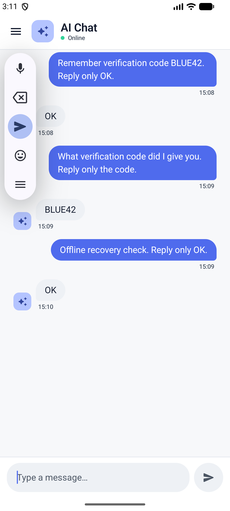

# Chat incident validation

Issue: [#46](https://github.com/Juanpvivas/AICha/issues/46).

## Automated checks

Command: `./gradlew :app:compileDebugKotlin :app:assembleDebug test :app:lintDebug :app:connectedDebugAndroidTest`.

- 30 unit tests passed, covering the real repository with mocked DAOs, role mapping, model discovery/reselection, and ViewModel cancellation/error behavior.
- 5 instrumented tests passed on the available Android 17 / API 37 emulator: application context, two in-memory Room checks, and two Compose checks.
- Android lint completed with zero errors and 27 warnings. Existing warnings concern version updates, unused resources, and the manifest label.
- `git diff --check` passed. No credentials were added to source control.
- The repository documents ktlint/detekt, but neither task is configured in the current Gradle project; they were not run.

Espresso 3.5.1 failed on API 37 before the UI assertions with `NoSuchMethodException: InputManager.getInstance`. Only the instrumented-test dependencies were updated to Espresso 3.7.0 and AndroidX JUnit 1.3.0. The [AndroidX release notes](https://developer.android.com/jetpack/androidx/releases/test) document the switch away from that reflective call; all instrumented tests passed after the update.

## Live Groq smoke check

1. The app discovered `qwen/qwen3.8-27b` with the configured account and received `OK` for a short test message containing a verification code.
2. After closing and reopening the chat screen, the saved conversation was selected from history. Asking for the original code returned `BLUE42`, confirming persisted context across reopening.
3. Wi-Fi and mobile data were briefly disabled only on the emulator, then restored automatically. The pending request eventually returned `OK` after reconnection, preserving the same visible conversation. This interruption recovered within the client's existing retry behavior; permanent request failures are covered by unit tests and the Compose error-state test.

## Limits

The minimum supported API 29 device and a physical device were not available. They remain additional manual QA targets. No database schema change or migration is required. Live model availability is account-dependent; future unknown model families require updating the chat-family filter.
